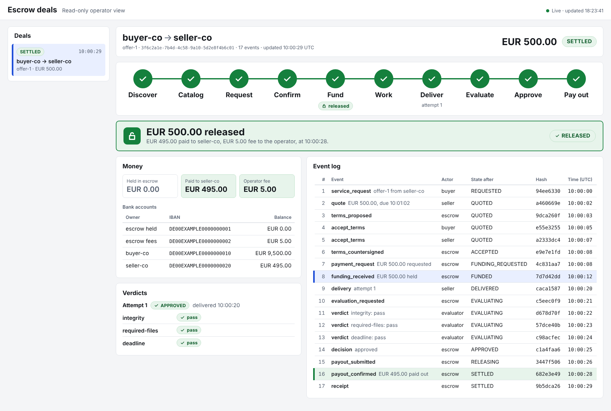

# dashboard

Read-only view of escrow deals for the live demo (SPEC §11.6, §13): which of the ten steps
a deal has reached, where its money is, what the evaluators said and the signed event log.
It only reads: three queries of the `cogit-finance-deals` module and the bank's account
list. There is no login and no write action.



More pictures: [broken run, settled after a redelivery](docs/broken.png) and
[the same run stopped at the rejection](docs/rejected.png).

## Run

For a fresh transaction through the buyer, seller, escrow and evaluator cores,
first run `bash scripts/dev-install.sh` from the repository root (Git Bash on
Windows). Then start the demo in PowerShell:

```powershell
.\.venv\Scripts\python.exe scripts/run_demo.py --port 8091
```

On Linux/macOS, use `.venv/bin/python scripts/run_demo.py --port 8091`.

Open **http://127.0.0.1:8091/demo**, choose **Successful delivery** or
**Failed delivery, then retry**, and click **Start €500 purchase**. The live view
shows the signed messages, evaluation results and bank balances. A completed
purchase offers a download of the actual ZIP produced by the seller.

This launcher uses the repository's reference modules, in-process agent runtime,
and simulated bank. It runs the agent logic and transfers simulated funds; it
does not use a deployed AgentDb worker or move real money. It loads the pinned
framework wheels already included in the checkout. Python needs `fastapi`,
`uvicorn`, `httpx`, `pyyaml`, `cryptography`, and the framework's dependencies
(the development setup below installs these).

The bank at `http://127.0.0.1:8080` is reused without resetting its balances; if it
is not running, the launcher starts it. Deals and artifacts live for the demo
process, and bank balances live for the bank process. `--step-delay 0` runs at full
speed; the default one-second pause between delivery rounds makes the progress
visible. Only the opt-in demo app has purchase controls. The standalone dashboard
below remains read-only.

For the existing recorded fixtures:

```sh
scripts/dev-install.sh                                             # once, from the repository root
.venv/bin/python -m dashboard --fixtures apps/dashboard/fixtures/happy    # http://127.0.0.1:8090
.venv/bin/python -m dashboard --fixtures apps/dashboard/fixtures/broken
```

| Setting | Default | Meaning |
| --- | --- | --- |
| `--fixtures <dir>` | required | A fixture set (layout below). Files are read again on every request |
| `DASHBOARD_PORT` / `--port` | `8090` | Port |
| `DASHBOARD_HOST` / `--host` | `127.0.0.1` | Bind address |
| `DASHBOARD_LOG_LEVEL` | `info` | Uvicorn log level |

Live data is wired in code, because the ports come from a host:

```python
from cogit_finance_seams import SimBankClient
from dashboard import ModuleSource, create_app

modules = host.port("dashboard", "operator_ro")          # any ModulePort; a read-only identity is enough
app = create_app(ModuleSource(modules, SimBankClient.from_url("http://localhost:8080")))
# uvicorn.run(app, port=8090)
```

`ModuleSource(modules, bank=None)` calls `deal.list`, `deal.read` and `ledger.balances` with
`module_query` and `bank.accounts()`; without a bank the account table stays empty.
`dump_source(source, directory)` writes whatever a source returns as a fixture set, so a
real run can be frozen and replayed: `dump_source(ModuleSource(modules, bank), "var/run-1")`.

## The page

One static page at `/`, plain JavaScript, served by the app with its CSS and script
(`src/dashboard/static/`). It polls every second and loads nothing from another host.
The dashboard and `/demo` use the landing page's Manrope font, forest green,
warm off-white and pale sage palette, shared brand mark, and compact workspace
layout. The font and its license are bundled under `static/assets/`.
The demo controls live in the same page as the deal, with no embedded dashboard.

- **Deals**: state, parties, offer, price, last update. The newest deal is shown until
  one is clicked; "Follow newest" returns to that. The selection lives in the URL fragment
  (`/#<deal_id>`).
- **Ten-step strip**: Discover, Catalog, Request, Confirm, Fund, Work, Deliver, Evaluate,
  Approve, Pay out. Each step is labeled as done, current, failed, or pending.
- **Money banner**: nothing held, waiting for the payment, held in escrow (accent), or
  released (green). Under it the deal's ledger balances and the bank accounts.
- **Verdicts** per delivery attempt and the **event log** (seq, event, actor, state after,
  first 8 characters of the hash, time).

`src/dashboard/steps.py` maps events to steps and
`src/dashboard/view.py` builds everything else, amounts included (`EUR 500.00` from
`50000`, integer arithmetic). The browser formats EUR as € and never calculates payments.

| Step | Done when | Current while |
| --- | --- | --- |
| 1 Discover, 2 Catalog, 3 Request | the deal exists (it starts with `service_request`) | |
| 4 Confirm | `terms_countersigned` | the deal exists |
| 5 Fund | `funding_received` | confirmed, not funded |
| 6 Work | first `delivery` | funded, nothing delivered |
| 7 Deliver | a `delivery` exists (the note names the attempt) | |
| 8 Evaluate | the `decision` on the last delivery approves; **failed** when it rejects | a delivery without a decision |
| 9 Approve | the `decision` on the last delivery approves | |
| 10 Pay out | `payout_confirmed` | approved, not paid |

A new `delivery` makes step 8 current again, so a successful redelivery ends with steps 7
to 10 green. A decision counts as approve or reject by the state it led to (`APPROVED`,
`REJECTED`); if that says nothing, by an `outcome` field anywhere in its body.

## API

All routes are `GET`. Errors answer `{"error", "message"}`; a failing source answers `502`.

| Route | Result |
| --- | --- |
| `/api/deals` | `{"deals": [...]}`: `deal.list` rows, newest first, plus `price`, `tone`, `updated_time` |
| `/api/deals/{deal_id}` | `{"deal", "steps", "money", "attempts", "timeline"}`; `404 unknown_deal` |
| `/api/balances?deal_id=` | `{"deal_id", "balances", "display"}` from `ledger.balances` |
| `/api/accounts` | `{"accounts": [...]}`: the bank's accounts plus `balance` |
| `/health` | `{"status": "ok"}` |

## Fixtures

A fixture set is a directory of module results, unchanged:

```text
deals.json                 deal.list          {"deals": [...]}
deals/<deal_id>.json       deal.read          {"deal", "events", "deliveries", "evaluations", "intents", "credits"}
balances.json              ledger.balances    all deals
balances/<deal_id>.json    ledger.balances    one deal
accounts.json              GET /accounts      {"accounts": [...]}
```

`fixtures/happy` is the SPEC §13.1 run (17 events). `fixtures/broken` is the run whose first
delivery lacks `summary.json` (22 events: `required-files` fails, reject, redelivery,
settled). Both are generated:

```sh
.venv/bin/python -m dashboard.make_fixtures                                        # both sets
.venv/bin/python -m dashboard.make_fixtures --run broken --until 13 --out /tmp/fx  # stopped at the rejection
```

The generator signs real envelopes and chains real event hashes with
`cogit-messaging-shim`. Its keys are random and discarded, so DIDs, signatures and hashes
change on every run. The bodies of E's own events (`decision`, `funding_received`, ...) are
this lane's guess; replace both sets with dumps of a real run (`dump_source`) when one exists.

Screenshots (Playwright with Chromium must be importable by the interpreter that runs the script):

```sh
python3 apps/dashboard/scripts/screenshots.py --server-python .venv/bin/python
python3 apps/dashboard/scripts/screenshots.py --server-python .venv/bin/python rejected=/tmp/fx/broken
```

## Test

```sh
scripts/test.sh apps/dashboard          # or: cd apps/dashboard && ../../.venv/bin/python -m pytest
```

The tests cover the step mapping (every prefix of the happy path, the broken run before
and after the redelivery), the API on both fixture sets and on intermediate states,
`ModuleSource` against a fake `ModulePort` that refuses commands, and that the page loads
nothing from another host.
